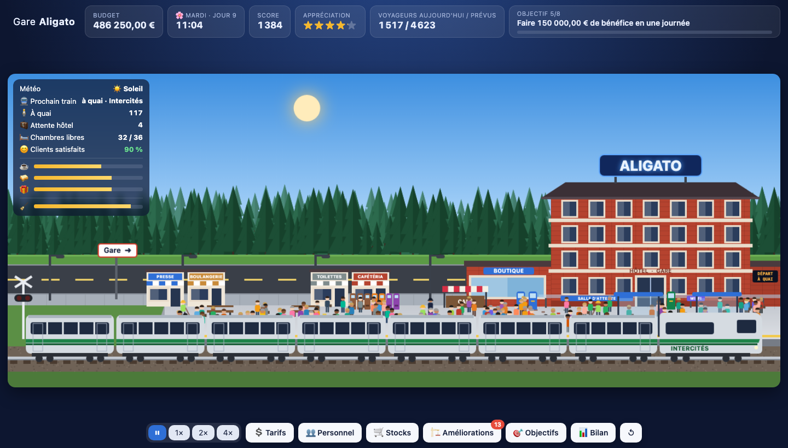

# Gare de train Aligato

Jeu de gestion d'une gare et de son hôtel, en HTML, CSS et JavaScript, sans dépendance.

Ce jeu rend hommage à *Aligato*, le jeu de gestion ferroviaire de **René Paradis**, dont il reprend l'esprit et la
mécanique. Il propose un style graphique moderne, plus détaillé et animé, à la place du pixel art d'origine.



## Lancer le jeu

Ouvrez simplement `index.html` dans un navigateur récent (double-clic) : aucun serveur ni installation n'est nécessaire.

Un serveur local reste possible, par exemple pour tester sur un autre appareil du réseau :

```bash
python3 -m http.server 8765
```

La partie est **sauvegardée automatiquement** dans le navigateur, chaque soir à minuit, après chaque achat ou embauche,
et quand on ferme la page. Le bouton ↺ en bas à droite lance une nouvelle partie.

## But du jeu

Vous dirigez la gare Aligato. Faites-la grandir, gardez vos voyageurs satisfaits et atteignez les 8 objectifs
pour devenir une **Légende du rail**.

## Comment jouer

### Première partie

Une visite guidée de 7 étapes présente l'écran (objectif, état de la gare, tarifs, personnel, stocks, améliorations, note).
Elle ne s'affiche qu'une fois ; « Passer » la ferme.

### Une journée

- Un train s'arrête toutes les heures, de 5 h à 23 h. Les voyageurs s'accumulent sur le quai pendant l'heure qui précède.
- À vitesse 1×, une journée dure environ 10 minutes. Boutons ⏸ 1× 2× 4× en bas, ou la barre **Espace** pour mettre en pause.
- **À minuit**, les frais du jour sont payés et un panneau de fin de journée s'ouvre : résumé, objectifs, prévisions du
  lendemain et conseils.
- La fenêtre **Bilan** montre aussi l'historique des 14 derniers jours : budget, résultat, voyageurs et appréciation
  (survolez un point ou une barre pour la valeur).

### La semaine

La partie commence un lundi.

- **Du lundi au vendredi**, des **express jaunes** passent à 6 h 30, 7 h 30, 17 h 30 et 18 h 30 avec les travailleurs
  (en costume sur le quai). Abonnés, ils ne passent pas au guichet, boivent beaucoup de café, achètent journaux et
  viennoiseries, mais ne dorment jamais à l'hôtel.
- Entre ces express circulent les **voyageurs classiques**.
- **Le week-end**, pas d'express : les voyageurs de loisir sont un peu plus nombreux, prennent deux fois plus de
  chambres et mangent davantage.

### Les voyageurs

Le nombre de voyageurs de la journée est fixé à minuit et reste stable. Il dépend de deux choses :

- **la clientèle attirée** : plus le billet est bon marché et la gare appréciée, plus il y a de monde.
  Ligne téléphonique, navette, parking et agrandissements de la gare en attirent davantage ;
- **la capacité de la gare** : le plus petit entre la taille du quai et les places libres dans le train.

Si la gare est **saturée**, montez le prix (vous gagnez plus sans perdre beaucoup de voyageurs) ou agrandissez-la.
Un billet moins cher attire plus de monde mais rapporte moins par voyageur : la fenêtre **Tarifs** indique le résultat
prévu et le **billet le plus rentable** pour le lendemain, et le bilan du soir conseille de s'en rapprocher.
Un changement de prix compte pour le lendemain.

### Le personnel

| Métier | Rôle | Remplaçable par |
|---|---|---|
| 🎫 Guichetiers | 45 billets par train. Sans billet, le voyageur reste à quai | Borne de billets (30 billets/train) |
| 🧹 Agents d'entretien | Nettoient le quai. Un quai sale fait baisser l'appréciation | Autolaveuse conduite (≈ 2 agents) |
| 🛎️ Personnel d'hôtel | 8 chambres par jour chacun | Borne de check-in (6 chambres/jour) |
| 🕵️ Contrôleurs (objectif 3) | Contrôlent 600 voyageurs par jour chacun, dissuadent la fraude et verbalisent (50 €) | — |
| ☕ Baristas (terrasse du café) | 600 cafés par jour chacun au-delà des 600 du comptoir | — |

La fenêtre **Personnel** donne l'effectif conseillé pour aujourd'hui et pour demain. Embaucher coûte 5 000 €,
licencier coûte 8 000 € d'indemnités.

### L'écran principal

En haut : budget, jour et heure, appréciation, voyageurs du jour, objectif en cours.
Sur la scène, en haut à gauche : voyageurs **à quai**, clients **en attente d'une chambre**, part de **clients satisfaits**
et niveau des trois stocks (un clic ouvre la fenêtre Stocks). Toutes les actions passent par les boutons du bas.

### L'hôtel

Une partie des voyageurs qui descendent veulent une chambre. Ils font la queue à la réception (on les voit avec leur valise)
et sont enregistrés au rythme du personnel d'hôtel et des bornes de check-in. Sur la façade, les chambres occupées ont les rideaux tirés,
allumées en soirée et éteintes la nuit. Si l'hôtel est plein, ils repartent ;
ceux qui attendent encore à minuit aussi.

### Stocks et distributeurs

Chaque visiteur peut acheter un ☕ café, un 🥪 repas ou un 🎁 goodies dans les distributeurs automatiques.
Un distributeur vide (écran rouge) fait des clients mécontents. Dans la fenêtre **Stocks** :

- **Remplir** un type de distributeur à tout moment (le réapprovisionnement est payé à minuit) ;
- **ajouter un distributeur** (4 au maximum par produit) pour tenir toute la journée ;
- activer ou non le **remplissage automatique** chaque nuit.

La fenêtre indique aussi la part servie avant les distributeurs par le café du quai, la cafétéria et la boutique
(200 goodies par jour dès l'agrandissement de la gare).

### Clients satisfaits et appréciation (★)

Un client est satisfait s'il a eu son billet, sa chambre ou son produit. L'appréciation se rapproche doucement
de la qualité de service : part de clients satisfaits, propreté, commerces, boutique, café.
Elle baisse vite si des voyageurs restent sans billet.

### Argent

- **Recettes** : billets, chambres d'hôtel, distributeurs, loyers des commerces, panneau publicitaire.
- **Frais quotidiens** : électricité (bâtiments et commerces), réapprovisionnement des distributeurs, blanchisserie,
  salaires, entretien des machines.
- **Découvert** : un budget négatif est toléré. S'il est encore négatif au 3ᵉ minuit de suite, c'est la faillite.

### Objectifs et améliorations

Chaque objectif atteint débloque de nouvelles améliorations, toutes visibles dans le décor.
On ne peut acheter qu'**un niveau de chaque amélioration par jour** (par exemple un seul niveau de bancs) :

| # | Objectif | Débloque |
|---|---|---|
| 1 | Transporter 2 000 voyageurs en une journée | Wagons, quai niveau 2, marchand de journaux |
| 2 | Accueillir 10 clients à l'hôtel en une journée | Étages d'hôtel, bornes de check-in, sanitaires |
| 3 | Atteindre 3,5 ★ | Bornes de billets, ligne téléphonique, boulangerie |
| 4 | Transporter 3 000 voyageurs en une journée | Boutique, autolaveuses, grand quai, wagons 7 et 8, librairie |
| 5 | Faire 150 000 € de bénéfice en une journée | Navette, café du quai, mini-supermarché |
| 6 | Accueillir 30 clients à l'hôtel en une journée | Parking, dernier étage d'hôtel |
| 7 | Transporter 5 000 voyageurs en une journée | Tour de l'horloge, panneau publicitaire |
| 8 | Atteindre 4,5 ★ | Le titre de Légende du rail |

Les commerces (marchand de journaux, boulangerie, librairie, mini-supermarché) apparaissent le long de la route.
Ils versent un loyer sur leurs ventes et améliorent l'appréciation. Les sanitaires ne rapportent rien
mais rendent le quai moins sale et les voyageurs plus contents.

### Sons

Le bouton 🔇 / 🔊 en bas à droite active le son : ambiance discrète du hall, tintement de pièces à chaque recette
de billets, et un son pour chaque action : amélioration, embauche,
licenciement, stocks et distributeurs. Il est coupé par défaut ; le choix est gardé dans le navigateur.

### Interface

Les fenêtres (tarifs, personnel, stocks, améliorations, objectifs, bilan) ont des onglets pour passer de l'une à
l'autre sans les fermer.

### Saisons

L'année compte 4 saisons d'une semaine (du lundi au dimanche), en commençant par le printemps. La saison s'affiche à côté du jour (survolez-la pour
savoir où vous en êtes), et le bilan du soir prévient la veille d'un changement.

| Saison | Météo dominante | Effets |
|---|---|---|
| 🌸 Printemps | Soleil, averses | — |
| 🌻 Été | Soleil, fortes chaleurs | Vacances : +20 % de voyageurs, +50 % de chambres, 30 % de travailleurs en moins |
| 🍂 Automne | Pluie | — |
| ⛄ Hiver | Neige fréquente | −10 % de voyageurs, −20 % de chambres |

### Score

Chaque soir, la journée rapporte jusqu'à **200 points** : appréciation (jusqu'à 100), part de clients satisfaits
(jusqu'à 50) et bénéfice (jusqu'à 50, atteint à 500 000 €). Les points s'additionnent dans le **score** affiché en haut ;
le meilleur score est gardé dans le navigateur. Une fois les 8 objectifs atteints, le score est le défi qui continue.

### Météo et confort

Chaque jour a sa météo, qui dépend de la saison, annoncée la veille dans le bilan et affichée sur la scène :
☀️ soleil, ⛅ nuageux, 🌧️ pluie, 🥵 forte chaleur, ❄️ neige. Pluie et neige font aussi venir un peu moins de monde ; par forte chaleur, on boit et on mange davantage.

Par pluie, neige ou forte chaleur, les voyageurs qui attendent **sans abri** font baisser l'appréciation.
Sont à l'abri : 60 voyageurs par **abri voyageurs** (3 au maximum, débloqués à l'objectif 1 ; le 2ᵉ demande le quai niveau 2, le 3ᵉ le grand quai) et ceux de la salle d'attente.
Les **bancs sur le quai** (3 niveaux, le premier dès le début, les suivants avec le quai niveau 2) ajoutent +0,05 ★ chacun.
Chaque banc s'installe sous l'abri de même rang : un abri équipé d'un banc donne +0,05 ★ de plus.

### Catégorie de la gare

L'amélioration **🚄 Catégorie de la gare** fait passer la gare à un réseau plus large. Elle est achetée une fois par niveau
et prend effet le lendemain.

| Catégorie | Conditions | Trains accueillis | Effets | Redevance |
|---|---|---|---|---|
| Gare régionale | Départ | 🚃 Régional toutes les heures | — | — |
| Gare nationale | Objectif 3, quai niveau 2, 150 000 € | 🚆 Intercités (gris et vert) toutes les deux heures | Billet ×1,6, +30 % de places, clientèle +15 % | 8 000 € / jour |
| Gare grande vitesse | Objectif 6, grand quai, 400 000 € | 🚄 TGV à 7 h, 9 h, 17 h et 19 h | Billet ×2,5, +60 % de places, clientèle +25 % ; le TGV attire moins de monde sous 4 ★ | 20 000 € / jour |

Le type du prochain train s'affiche sur la scène (« 09:00 · TGV »).

### Confort des trains

- 🛋️ **Rénovation des wagons** (3 niveaux, objectifs 1, 3 et 5) : sièges confortables, climatisation, prises et Wi-Fi.
  Chaque niveau donne +0,1 ★ et +5 % de clientèle, et change la livrée du train. La climatisation divise par deux
  la gêne des jours de forte chaleur.
- 🍷 **Voiture-bar** (objectif 4) : un wagon bordeaux « BAR » s'ajoute aux trains normaux. Les voyageurs y achètent
  à bord, et la demande de cafés et de repas aux distributeurs baisse de 15 %.

### Services

| Service | Débloqué à l'objectif | Effet |
|---|---|---|
| 📶 Wi-Fi gratuit | 1 | Appréciation +0,15 |
| 👮 Agent de sécurité | 1 | Fait fuir les vandales (sinon 15 000 € de dégâts) ; on le voit faire sa ronde |
| 📺 Écrans d'information | 2 | Guichets et bornes 25 % plus efficaces ; écran des départs sur la gare |
| 🪑 Salle d'attente (2 niveaux) | 2 et 5 | +80 puis +160 voyageurs par train sans agrandir le quai ; on voit les silhouettes derrière les vitres |
| ☕ Café du quai (3 niveaux) | 5, 6 et 7 (quai niveau 2, puis boutique) | 600 cafés par jour à 3,50 € sans personnel ; **Terrasse** : jusqu'à 1 500 cafés et viennoiseries à 6 € ; **Grand café** : jusqu'à 2 700. Au-delà de 600, il faut des **baristas** (1 200 €/jour, 600 cafés chacun). Appréciation +0,4, puis +0,1 par niveau |
| 🍽️ Cafétéria | 3 | Repas à 18 € servis par des **serveurs** (nouveau métier), avant les distributeurs ; les clients de l'hôtel y dînent |
| 🧳 Consigne à bagages | 3 | Recette sur les voyageurs de loisir, surtout le week-end |
| 📦 Point relais colis | 4 | Recette sur les travailleurs |
| 🧖 Spa de l'hôtel | 6 (hôtel de 3 étages) | Chambres 30 % plus chères le week-end |
| 🙋 Accueil voyageurs | 2 | Agents d'accueil : 5 % d'abandons au lieu de 15 % quand un train est en retard, 20 billets par train sur tablette (même en grève), la moitié des voyageurs sans billet attendent le train suivant s'il reste de la place à quai |
| 💎 Salon 1re classe | 6 (gare nationale) | Billet double pour 10 % des voyageurs dès 4 ★ (3 % sinon) |

Chaque service coûte un entretien quotidien, visible dans la fenêtre Améliorations.
La cafétéria, le café du quai et la boutique servent en premier : les distributeurs ne prennent que le reste de la demande.

### Fraude et contrôleurs

À partir de l'objectif 3, une partie des voyageurs monte sans billet : 2 % plus jusqu'à 10 % selon le prix du billet,
et une partie de ceux qui n'ont pas pu acheter de billet. Les **contrôleurs** dissuadent la fraude (jusqu'à −70 %)
et verbalisent les fraudeurs pris (50 €). Au-delà de 8 % de fraude, l'appréciation baisse.
La fenêtre Personnel conseille l'effectif le plus rentable, et le bilan du soir indique le nombre de fraudeurs.

### Incidents

- 🕒 **Train en retard** : 15 % des voyageurs qui attendaient abandonnent (5 % avec l'accueil voyageurs), et l'appréciation baisse.
- ⚠️ **Distributeur en panne** (écran orange clignotant) : il ne vend plus sa part du stock. Réparez-le dans la fenêtre
  Stocks (1 500 €) ; sinon il est réparé la nuit pour 3 000 €.
- 🔧 L'**atelier de maintenance** (objectif 2) rend retards et pannes 4 fois plus rares et répare les distributeurs dans l'heure.

### Événements

Une fois par jour au plus, un imprévu peut survenir : car de touristes, congrès en ville, panne de courant, vandalisme, grève des guichetiers pendant 3 heures (ils vendent deux fois moins, les bornes fonctionnent normalement),
article de presse ou inspection sanitaire (amende si le quai est sale).

## Vérifier l'équilibrage

```bash
node sim.mjs
```

Joue 3 parties de 56 jours (deux années) sans navigateur, avec une stratégie simple, et échoue si une journée finit en perte,
si le budget reste négatif deux soirs de suite, en cas de faillite ou si les 8 objectifs ne sont pas atteints avant le jour 40.
Options : `node sim.mjs <parties> <jours>`.

## Fichiers

- `index.html` : structure de la page
- `style.css` : interface
- `game.js` : simulation, rendu du décor (canvas) et fenêtres
- `sim.mjs` : vérification automatique de l'équilibrage
